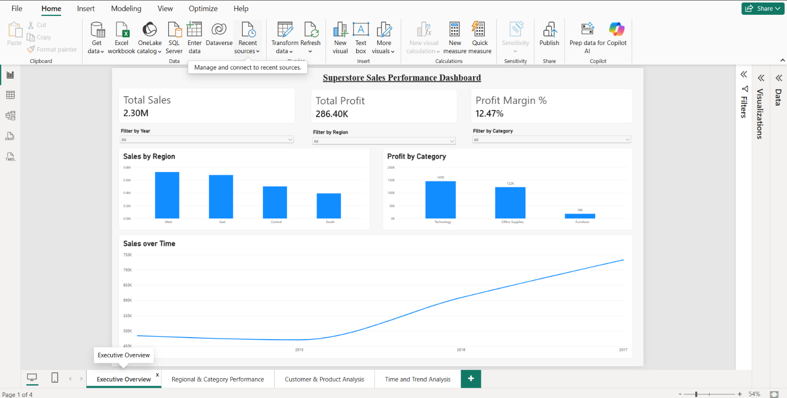
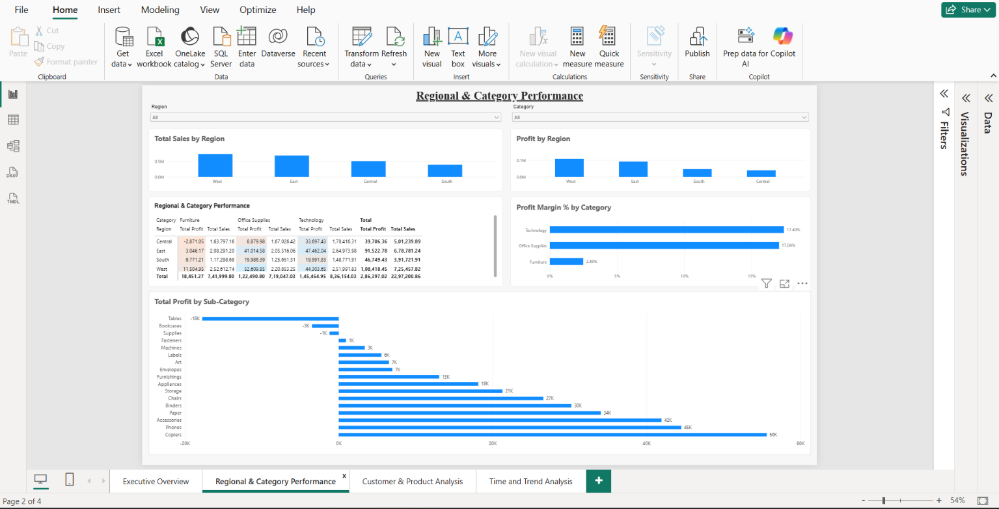
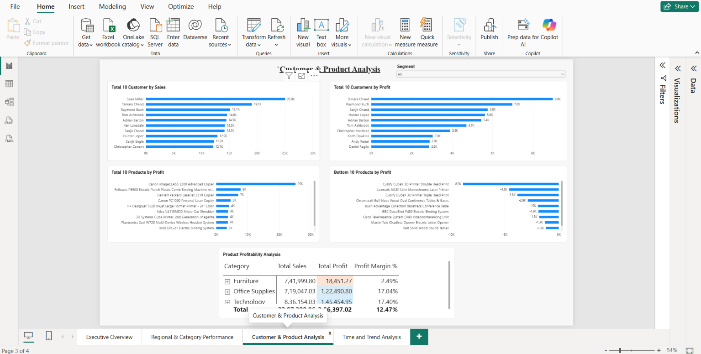
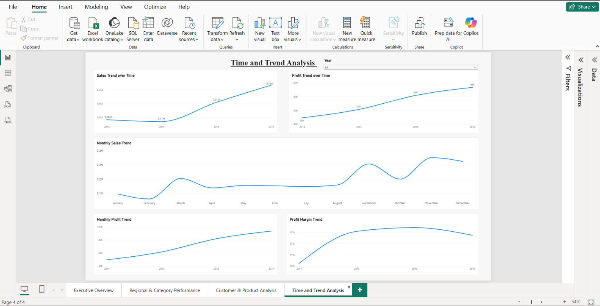

# Superstore Sales Performance Analysis

## 📌 Project Overview

This project analyzes the **Sample Superstore** dataset to understand sales performance, profitability, customer behavior, product performance, regional trends, and changes over time.

The main business objective is to identify **high-performing and loss-making areas** and provide an interactive dashboard that can support business decisions such as **Q4 resource allocation**.

The project combines **Python, SQL, and Power BI** to demonstrate an end-to-end data analysis workflow.

---

## 🎯 Business Problem

A retail business wants to understand:

* Which regions generate the most sales and profit?
* Which categories and sub-categories perform well?
* Which products and customers contribute the most profit?
* Which products or sub-categories are loss-making?
* How do sales and profit change over time?
* Are there areas where high sales do not translate into high profitability?
* Which areas should receive further attention when planning resources?

---

## 📊 Dataset

The project uses the **Sample Superstore** dataset.

### Dataset Size

* **Rows:** 9,994
* **Columns:** 21
* **Data type:** Retail sales transactions

### Important Columns

* Order ID
* Order Date
* Ship Date
* Ship Mode
* Customer ID
* Customer Name
* Segment
* Country
* City
* State
* Region
* Product ID
* Category
* Sub-Category
* Product Name
* Sales
* Quantity
* Discount
* Profit

---

## 🛠️ Tools & Technologies

### Python

* Pandas
* Matplotlib
* Jupyter Notebook

Used for:

* Data loading
* Data cleaning
* Missing-value analysis
* Date feature engineering
* Exploratory Data Analysis (EDA)
* KPI calculation
* Regional analysis
* Category and sub-category analysis
* Discount analysis
* Customer analysis
* Product analysis
* Time-series analysis
* Root-cause investigation of loss-making areas

### SQL

SQLite was used for querying the dataset.

SQL techniques used include:

* SELECT
* WHERE
* GROUP BY
* ORDER BY
* HAVING
* Aggregate functions
* CASE
* CTEs
* Window functions
* RANK()
* LAG()
* Date functions
* Customer analysis
* Product analysis
* Year-over-year analysis

### Power BI

Used to build an interactive **4-page dashboard** containing:

* KPI cards
* Charts
* Slicers
* Top/Bottom-N analysis
* Profitability matrix
* Trend analysis
* Conditional formatting

---

## 🔄 Project Workflow

```text
Raw Dataset
     ↓
Data Loading & Cleaning
     ↓
Exploratory Data Analysis
     ↓
Python Analysis
     ↓
SQL Analysis
     ↓
Power BI Dashboard
     ↓
Business Insights
```

---

# 📈 Python Analysis

The Python analysis was performed using Pandas and Matplotlib.

### Analysis Performed

1. Dataset inspection
2. Missing-value check
3. Data type conversion
4. Date feature engineering
5. KPI calculation
6. Regional performance analysis
7. Category performance analysis
8. Sub-category profitability analysis
9. Discount analysis
10. Time-based sales and profit analysis
11. Segment analysis
12. Region × Category analysis
13. Product-level analysis
14. Customer-level analysis
15. Loss-making area investigation

Date-related features created during analysis included:

* Year
* Month
* Month Name
* Year-Month

---

# 🧮 SQL Analysis

The dataset was loaded into a SQLite database for structured querying.

### Key SQL Analysis

#### Overall KPIs

Calculated:

* Total Sales
* Total Profit
* Total Quantity

#### Regional Analysis

Compared regions based on:

* Sales
* Profit
* Quantity

#### Category & Sub-Category Analysis

Analyzed:

* Sales
* Profit
* Profit Margin
* Loss-making sub-categories

#### Product Analysis

Used SQL ranking to identify:

* Top products by profit
* Bottom products by profit
* Top 3 products within each category
* Loss-making products

#### Customer Analysis

Analyzed:

* Customer sales
* Customer profit
* Number of orders
* Customer profitability
* Loss-making customers

#### Time Analysis

Used SQL date functions and window functions to analyze:

* Yearly sales
* Yearly profit
* Monthly sales
* Monthly profit
* Year-over-year sales growth
* Year-over-year profit growth

---

# 📊 Power BI Dashboard

# 📸 Dashboard Preview

### Executive Overview



### Regional & Category Performance



### Customer & Product Analysis



### Time & Trend Analysis




The Power BI report contains **four pages**.

## 1. Executive Overview

Provides a high-level summary of business performance.

### Includes:

* Total Sales
* Total Profit
* Profit Margin
* Sales by Region
* Profit by Category
* Sales Trend Over Time
* Year slicer
* Region slicer
* Category slicer

---

## 2. Regional & Category Performance

Focuses on regional and category-level profitability.

### Includes:

* Sales by Region
* Profit by Region
* Regional & Category Performance Matrix
* Profit Margin by Category
* Profit by Sub-Category
* Region slicer
* Category slicer

Conditional formatting is used to make profitable and loss-making areas easier to identify.

---

## 3. Customer & Product Analysis

Focuses on customer and product performance.

### Includes:

* Top 10 Customers by Sales
* Top 10 Customers by Profit
* Top 10 Products by Profit
* Bottom 10 Products by Profit
* Product Profitability Analysis Matrix
* Segment slicer

The profitability matrix provides:

* Sales
* Profit
* Profit Margin

at the category, sub-category, and product levels.

---

## 4. Time & Trend Analysis

Analyzes how business performance changes over time.

### Includes:

* Sales Trend Over Time
* Profit Trend Over Time
* Monthly Sales Trend
* Monthly Profit Trend
* Profit Margin Trend
* Year slicer

---

# 🔍 Key Findings

The analysis identified several notable patterns.

### Product & Sub-Category Performance

* **Phones** generated the highest sales among the sub-categories.
* **Copiers** generated more total profit than Phones despite having lower sales.
* **Tables** generated high sales but had negative total profit.
* **Bookcases** and **Supplies** also recorded negative total profit.
* **Paper, Labels, and Envelopes** showed relatively high profit margins.
* **Machines** generated substantial sales but had a comparatively low profit margin.

### Profitability

The analysis demonstrates that **high sales do not necessarily mean high profitability**.

For example, some sub-categories generated substantial revenue while producing low or negative profit.

This makes profit margin and total profit important metrics alongside sales.

### Further Investigation

Discount and regional patterns were also examined for loss-making categories and products to identify areas requiring further analysis.

The project does not assume that discount or region is the cause of losses without supporting analysis.

---

# 📁 Project Structure

```text
Superstore Data Analysis/
│
├── README.md
│
├── data/
│   ├── Sample - Superstore.csv
│   ├── superstore.db
│   ├── customer_analysis.csv
│   ├── top_customers_sales.csv
│   ├── top_customers_profit.csv
│   └── segment_customer_analysis.csv
│
├── notebooks/
│   └── superstore_analysis.ipynb
│
├── sql/
│   └── superstore_analysis.sql
│
├── powerbi/
│   └── Superstore_Sales_Performance_Analysis.pbix
│
└── screenshots/
    ├── executive_overview.png
    ├── regional_category.png
    ├── customer_product.png
    └── time_trends.png
```

---

# 💡 Business Value

The dashboard is designed to help stakeholders:

* Monitor overall sales and profitability
* Identify strong and weak regions
* Compare category performance
* Identify profitable and loss-making products
* Understand customer contribution
* Monitor sales and profit trends
* Investigate areas requiring further attention
* Support Q4 resource allocation discussions

---

# 📌 Resume Description

**Superstore Sales Performance Analysis**

Analyzed **9,994 retail transactions** using Python, SQL, and Power BI to evaluate regional, category, customer, product, and time-based sales and profitability patterns. Built a **4-page interactive Power BI dashboard** with KPI cards, slicers, Top/Bottom-N analysis, profitability matrices, and trend analysis.

---

## 📚 Skills Demonstrated

* Data Cleaning
* Exploratory Data Analysis
* Python
* Pandas
* Matplotlib
* SQL
* SQLite
* Aggregations
* GROUP BY
* HAVING
* CTEs
* Window Functions
* RANK()
* LAG()
* Date Analysis
* Customer Analysis
* Product Analysis
* Business Analysis
* Power BI
* Data Visualization
* Dashboard Development
* Business Insights

---

## 👤 Author

**Bhumika Gadade**

BTech – Electronics & Telecommunication Engineering

Interested in **Data Analytics, AI, and Machine Learning**.
